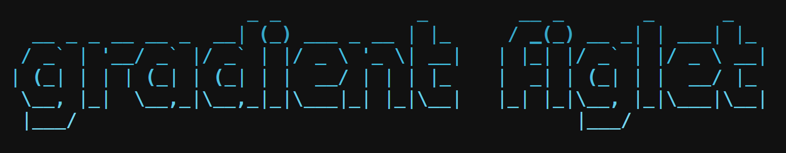
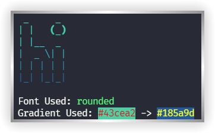
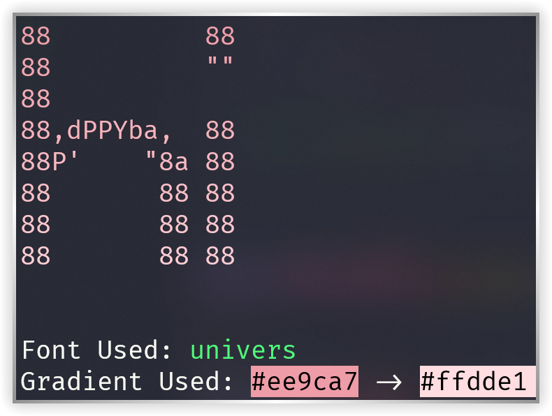
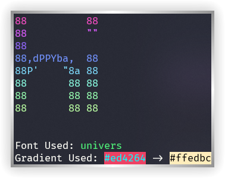
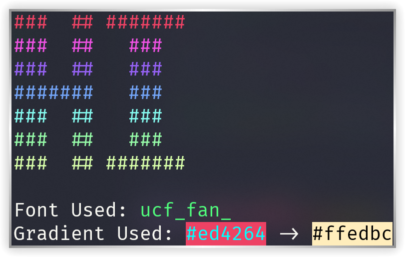
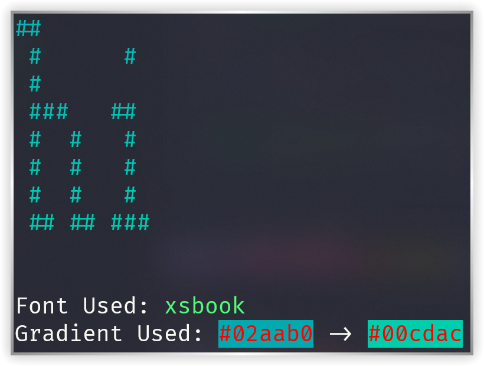
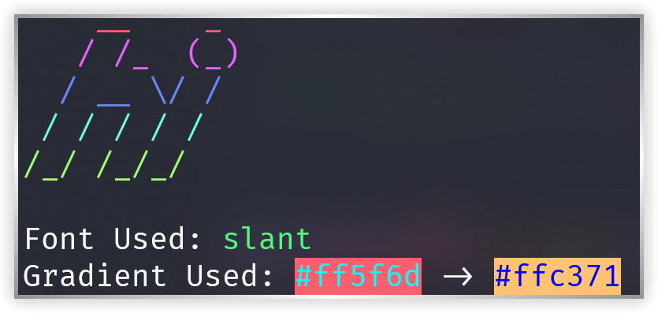

<div align="center"> <h1 align="center"> Gradient Figlet </h1>

A CLI and library that prints (optionally outputs html) gradient figlets using [rich](https://github.com/Textualize/rich "Rich is a Python library for rich text and beautiful formatting in the terminal.") and [pyfiglet](https://github.com/pwaller/pyfiglet "An implementation of figlet written in Python.")
 </div>

## Installation

```sh
pip install gradient_figlet
```

## Usage (CLI)

To just test out the tool with some pre-determined pleasant parameters, run:

```sh
gradient-figlet YOUR_TEXT
# or equivalently:
python -m gradient_figlet YOUR_TEXT
```

And change YOUR_TEXT to something else that you want.

To get all the information about the parameters, run:

```sh
gradient-figlet -h
```

### Common examples

```sh
# Pick specific gradient colors (color names or hex codes, two or more)
gradient-figlet "Hello" -c "#ff512f,#dd2476"
gradient-figlet "Hello" -c "red,yellow,blue"

# A single color generates a matching second shade automatically
gradient-figlet "Hello" -c red

# Use a built-in named gradient (case-insensitive)
gradient-figlet "Hello" -g "Endless River"

# See all the built-in named gradients / all the available font names
gradient-figlet x --list-gradients
gradient-figlet x --list-fonts

# Preview your text in every available font (uses random gradients)
gradient-figlet "Hello" -F --pager

# Pick a font, center it, and also save the output as HTML
gradient-figlet "Hello" -f slant -j center -html
```

### All options

| Option | Description |
| ------ | ----------- |
| `-c`, `--color` | Comma separated gradient stops (color names or hex codes, one or more). Random named gradient if omitted. |
| `-g`, `--gradient` | Use a built-in named gradient (see `--list-gradients`). |
| `-f`, `--font` | The pyfiglet font to use. Random pleasant font if omitted. |
| `-F`, `--all-fonts` | Preview the text in every available font. |
| `--list-gradients` | List all the built-in named gradients and exit. |
| `--list-fonts` | List the names of all the available fonts and exit. |
| `-p`, `--pager` | Show the output in a pager (useful with `-F`). |
| `-d`, `--direction` | `auto` (default), `left-to-right` or `right-to-left`. |
| `-j`, `--justify` | `auto` (default), `left`, `center` or `right`. |
| `-w`, `--width` | The width to render in, defaults to the terminal width. |
| `-html`, `--save-html` | Also save the output as an HTML file named after the text. |

## Usage (library)

```python
from gradient_figlet import print_with_gradient_figlet

# Render "Hello" as a figlet and print it with a gradient
print_with_gradient_figlet("Hello", font="slant", color1="#ff512f", color2="#dd2476")
```

If you want to compose the output into your own [rich](https://github.com/Textualize/rich) UI,
use `make_gradient_figlet` / `make_gradient`, which return a `rich.text.Text`:

```python
from rich.console import Console
from rich.panel import Panel
from gradient_figlet import make_gradient_figlet

console = Console()
text = make_gradient_figlet("Hello", "red", "yellow", "blue", font="big")
console.print(Panel(text, title="greeting"))
```

### API

- `make_gradient(text, *colors)` — apply a vertical gradient to any multiline text, returns `rich.text.Text`.
- `make_gradient_figlet(text, *colors, font="standard", direction="auto", justify="auto", width=...)` — render a figlet and apply a gradient, returns `rich.text.Text`.
- `print_with_gradient(text, color1, color2, *extra_colors, also_to_html=False, original_text=None)` — print multiline text with a gradient.
- `print_with_gradient_figlet(text, font, color1, color2, *extra_colors, direction="auto", justify="auto", width=..., save_html=False)` — render a figlet and print it with a gradient.
- `interpolate_colors(colors, steps)` — interpolate any number of gradient stops into `steps` colors, returns a list of `colour.Color`.

All colors can be given as `colour.Color` objects, color names (`"red"`), or hex codes (`"#ff512f"`).
Gradients can have any number of stops.

There is a runnable tour of the library in [examples/demo.py](examples/demo.py).

## Screenshots







